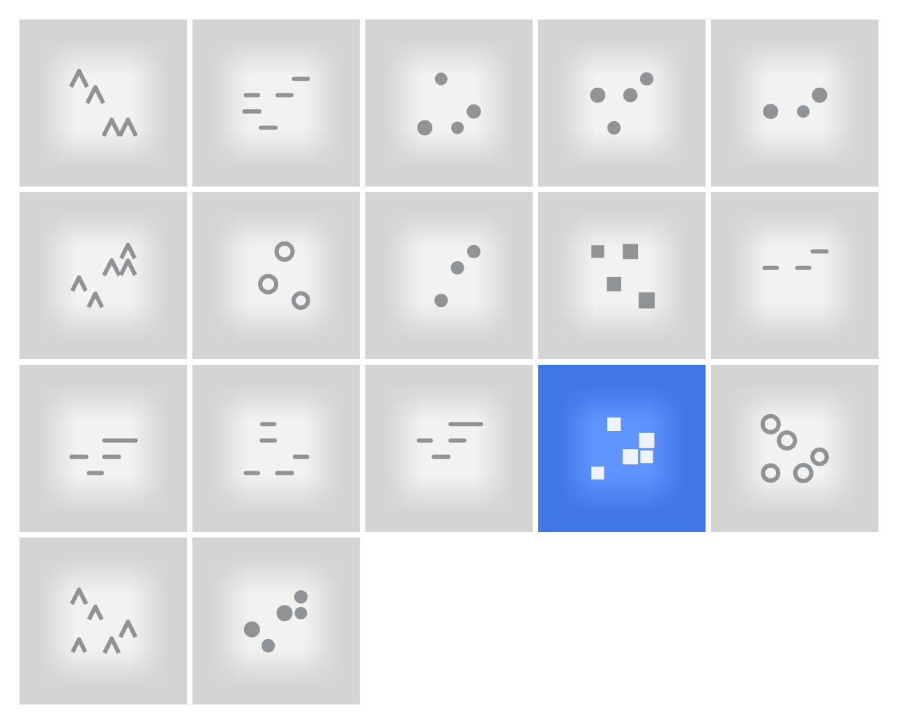
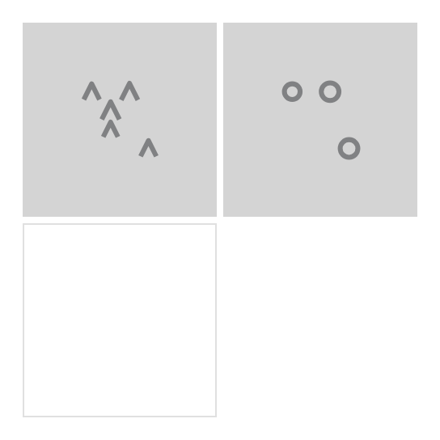

# dsh-grid-gui

把 DeepSeek Harness 的工作区视图换成一面方块矩阵：每个工作区是一格，点进去是它的会话，每格的颜色就是它的状态。





## 它做什么

- **一层**：主区是工作区方格，一格一个工作区。
- **二层**：点一格进入，主区变成该工作区的会话方格，末尾一格「+」新建会话。
- **侧栏**：原来的工作区列表替换成一排横条，一行一个工作区；点条等于回到一层并进入该工作区。
- **颜色**：方块颜色反映该工作区里会话的运行状态（见下文）。
- **图标**：任何方块都能换成 emoji 或一张图片，图标跟着状态色走。

## 操作

| 操作 | 结果 |
| --- | --- |
| 点一层方块 | 进入该工作区（二层） |
| 点二层会话格 | 打开该会话 |
| 点二层「+」格 | 在该工作区新建会话并进入（离开矩阵） |
| 点顶部「◀」或会话头部返回 | 回到一层 |
| 右键一层方块 | 新建会话、换图标、重命名工作区、删除工作区 |
| 右键二层会话格 | 打开、置顶、归档、换图标 |
| `Ctrl` + 拖动二层会话格 | 在本工作区内换位 |

**右键菜单按层分离。** 删除工作区不可逆，所以它只出现在一层。二层的会话操作里没有任何工作区级别的动作，「+」格没有右键菜单。

## 颜色：状态怎么映射成颜色

一层每格的颜色由**该工作区内会话的状态构成**决定。只统计运行、等待、完成、失败四种；闲置会话不参与。所以一个有 40 个闲置会话和 1 个运行中会话的工作区是「运行」，而不是「75% 闲置」。

每个会话的状态按优先级判定：

1. **等待**：有待你处理的请求（`pendingInteraction`）
2. **完成 / 失败**：本轮已结束且你还没看（`completionUnread`），再看这一轮是怎么结束的（见下）
3. **运行**：正在跑
4. **闲置**：以上都不是

### 七种视觉

四种状态可以组成 15 种非空组合，画法分三类：

| 组合 | 画法 |
| --- | --- |
| 单一状态（4 种） | 纯色：运行蓝 `#4176e6`、等待琥珀 `#f59e0b`、完成绿 `#22c55e`、失败红 `#e5484d` |
| 两种状态（6 种） | 沿反对角线对半切开，两种纯色各占一半 |
| 三种及以上（5 种） | 纯紫 `#a369de` |

### 为什么两种状态用对半切，而不是混合

把两种颜色混合会得到第三种颜色：蓝和琥珀混合出来是灰，灰在灰底上就是一块看不清的暗斑。所以两种状态各占一半，直接在对角线上相接，方块里只有这两种颜色。

接缝刻意保持硬边。对角线正好穿过右上角和左下角，接缝一旦做软，这两个角就会出现混合色。

### 为什么三种及以上用纯紫

一个方块里挤三种颜色已经不是一眼能读的信息了，而这块板子的全部用途就是一眼看完。纯紫是唯一没被单一状态或两两组合占用的颜色，用它表示「三种都有」。

## 失败是怎么来的

DSH 的状态模型只有 `running`、`pendingInteraction`、`completionUnread` 三个字段，**没有失败**。一轮结束不论原因，都会置 `completionUnread`。所以只看这三个字段，超时和正常完成看起来一模一样。

为此插件在宿主侧注册了投影 `gridGuiOutcome`，在每轮 `turn/end` 时记录结束原因：

| 结束原因（`reason.kind`） | 显示为 |
| --- | --- |
| `error`（超时、余额不足、工具报错等） | **失败（红）** |
| `completed` | 完成（绿） |
| `aborted`（你主动停止）、`blocked`、`interrupted`、`max-tokens`、`forked` | 完成（绿） |

你主动停止的轮次不算失败，这是有意的：它是你自己的选择，不是故障。

投影尚未生成时（例如刚装上、宿主还没重启），失败无法区分，所有已结束的会话都按完成显示。

## 图标

每个方块可以换图标，入口是右键 →「换图标」：

- **emoji**：内置 24 个快选，或自己输入
- **图片**：上传后在浏览器里处理，裁成正方形、缩到 96×96、转灰度、编码为 WebP（不支持 WebP 时用 PNG）。原图不会被上传或保存，存下的只有处理后的小图
- **恢复默认**：去掉图标，回到标题指纹

图标是灰度的，透明度 0.55，用 `mix-blend-mode: luminosity` 叠在方块上，所以方块的颜色仍由状态决定，图标只提供明暗和形状。运行中的工作区，图标会呈蓝色；完成的呈绿色。

没有图标的方块显示标题指纹：同一个标题永远是同一个图案。

## 侧栏

侧栏的每个横条是一个工作区，长度代表会话总量，内部颜色段代表状态构成。静止时短一些，悬停或选中时展开到完整长度。侧栏折叠成窄轨时不显示横条。

## 数据和存储

插件不维护自己的工作区或会话状态，全部读取宿主已有的服务：工作区与会话列表、会话状态，以及打开、归档、置顶、换位、改名、删除等操作。

以下会话不出现在矩阵里，与自带的工作区浏览器一致：子会话（`origin === "subagent"`）、空白占位会话、已归档会话。不属于任何工作区的会话归入末尾的「未归类」一格（有散落会话时才出现）。

**只有图标是插件自己存的**：

- 存储域 `dsh_grid_gui`，表 `icons`，文件 `~/.dsh/storages/dsh_grid_gui.json`
- 键为 `w:<工作区 id>` 或 `s:<会话 id>`，值为 `{ kind: "emoji" | "image", value }`

两条路由，都要先通过宿主的 `connection.requestRejection` 信任检查，未通过返回 401：

```
GET /grid-gui/icons   →  { icons: { [key]: { kind, value } }, storage: true | false }
PUT /grid-gui/icons   ←  { key, icon: { kind, value } | null }     null 表示恢复默认
```

限制：PUT 请求体上限 256 KiB，单个图标值上限 128 KiB。`storage: false` 表示宿主没有提供存储服务，方块仍然正常显示，只是图标无法保存。

插件没有外部依赖。

## 安装

前提：一个 DeepSeek Harness 的 web profile。

插件是本地链接包。用插件管理器安装，不要手改 profile 文件：

```
install_bundle   target = <本仓库的绝对路径>
```

安装后 profile 的 `package.json` 会多一条 `"dsh-grid-gui": "link:…"`，`bundles` 列表里加入 `dsh-grid-gui`，并由包自带的 patch 注入：

```yaml
- insert:
    - id: dsh-grid-gui
      name: 'dsh-grid-gui'
```

**改名后不能只 `mv` 目录。** 依赖链接、`bundles` 条目和 lockfile 里都记着旧名字，必须先 `remove_bundle` 再 `install_bundle`。

装好后页面没变化，可以把 `include:dsh-grid-gui` 这一项关掉再打开。`cordis_inspect` 里它的 Config 状态可能显示 `absent`，这是 worker 缓存的已知现象，不代表没加载。验证加载与否，看路由是否返回 200：

```bash
curl -s -H "cookie: <签名 cookie>" http://127.0.0.1:3080/grid-gui/icons
```

## 文件

| 文件 | 作用 |
| --- | --- |
| `index.js` | 宿主半边：图标存储、两条路由、结束原因投影 `gridGuiOutcome` |
| `client.js` | 浏览器半边：两层矩阵、侧栏横条、右键菜单、图标面板、全部样式 |
| `cordis.patch.yml` | 注入 `include:dsh-grid-gui` |
| `locale/zh.json`、`locale/en.json` | 插件管理器里显示的标题与描述 |
| `icon.svg` | 插件管理器里的图标 |
| `docs/palette.html` | 七种颜色的对照页 |

## 已知限制

- **没有「保留原色」图标。** 图标的颜色交给状态决定，允许彩色图标会盖掉状态色。适合的图是明暗对比强的剪影或线稿。
- **一层没有「新建工作区」格子。** 侧栏原有的列表已被横条替代，新建工作区请用「新建会话」页工作区菜单底部的「添加工作区…」。
- **视图状态不落盘。** 刷新页面后回到一层。
- **接缝硬边。** 两种状态的对半接缝是有意的硬边，换来的是方块里只有两种颜色。
- **失败需要宿主重启才完整。** `gridGuiOutcome` 投影在宿主加载插件时注册，之前的已结束会话在注册前无法判定为失败。
